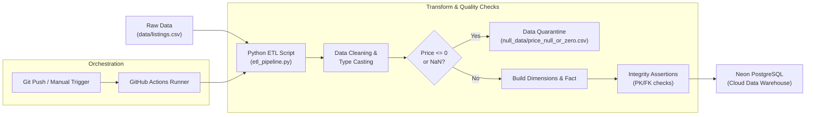
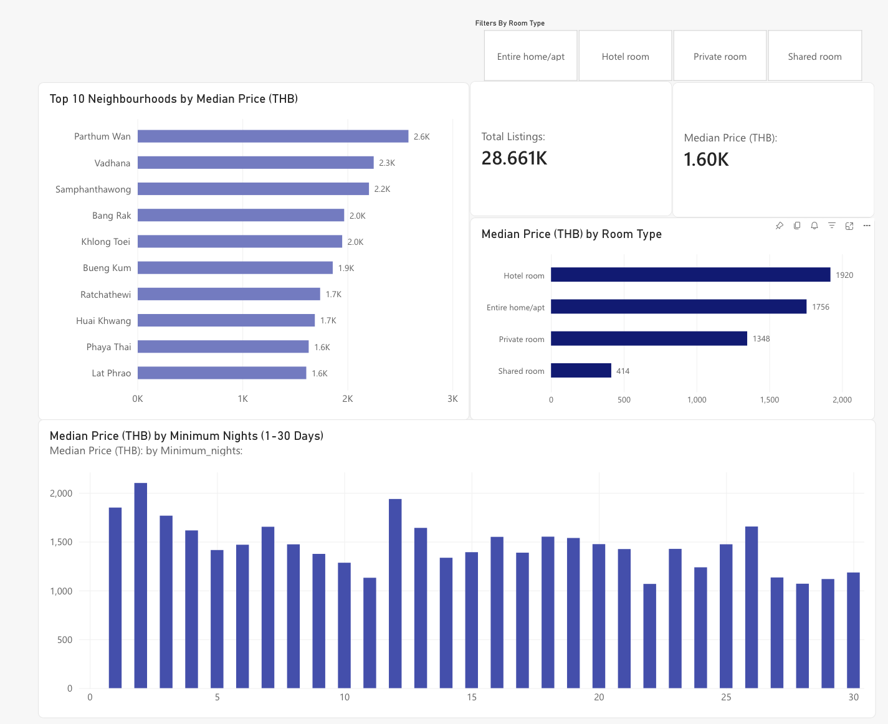
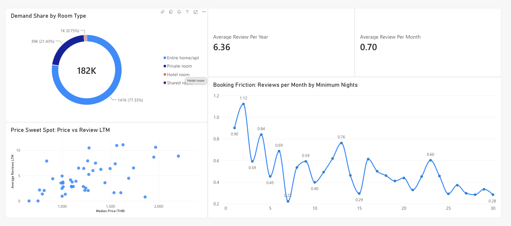
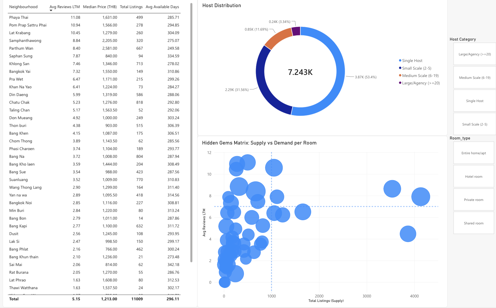
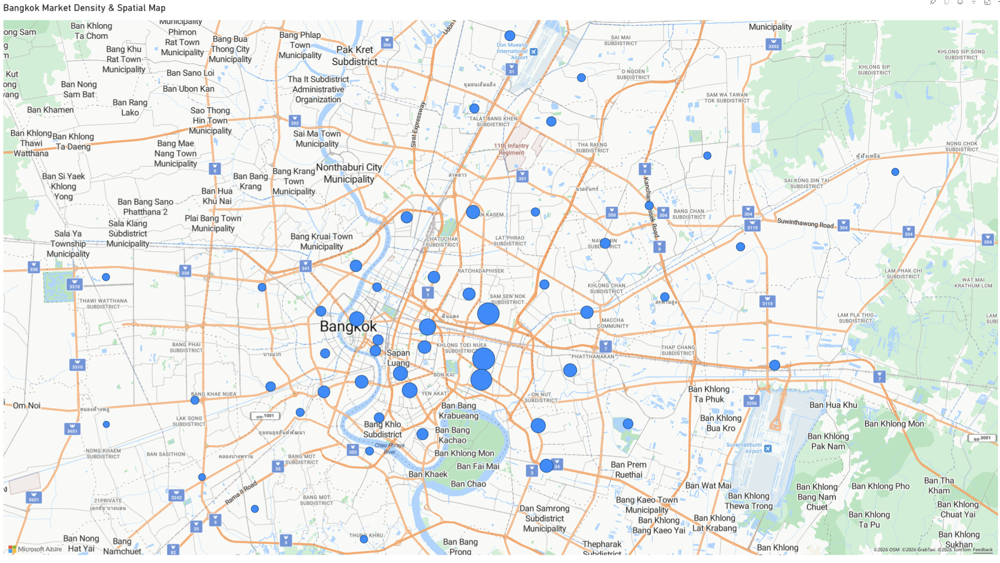

# 🏠 Airbnb Bangkok Automated ETL Pipeline & Data Warehouse

[](https://www.python.org/)
[](https://neon.tech/)
[](https://github.com/features/actions)
[](bi/)
[](https://pandas.pydata.org/)
[](https://www.sqlalchemy.org/)
[](LICENSE)

ระบบ Automated Data Pipeline แบบ End-to-End สำหรับสกัด (Extract), ทำความสะอาดและแปลงรูป (Transform), และนำเข้า (Load) ข้อมูลที่พัก Airbnb ในเขตกรุงเทพมหานคร สู่ Cloud Data Warehouse (Neon Serverless PostgreSQL) ตามหลักการ **Dimensional Modeling (Snowflake Schema ในรูปแบบ 3NF)** เพื่อรองรับการวิเคราะห์ Business Intelligence (BI) และตอบโจทย์การลงทุนปล่อยเช่าห้องพักอย่างมีประสิทธิภาพ

---

## 📌 สารบัญ (Table of Contents)
1. [โจทย์และวัตถุประสงค์ทางธุรกิจ (Business Objectives)](#-โจทย์และวัตถุประสงค์ทางธุรกิจ-business-objectives)
2. [สถาปัตยกรรมข้อมูลและไปป์ไลน์ (Architecture Overview)](#-สถาปัตยกรรมข้อมูลและไปป์ไลน์-architecture-overview)
3. [การออกแบบโมเดลข้อมูล (Data Modeling)](#-การออกแบบโมเดลข้อมูล-data-modeling)
4. [นโยบายคุณภาพข้อมูล (Data Quality & Quarantine Policy)](#-นโยบายคุณภาพข้อมูล-data-quality--quarantine-policy)
5. [โครงสร้างโปรเจกต์ (Project Structure)](#-โครงสร้างโปรเจกต์-project-structure)
6. [การติดตั้งและใช้งาน (Getting Started)](#-การติดตั้งและใช้งาน-getting-started)
7. [ระบบอัตโนมัติ (CI/CD Automation with GitHub Actions)](#-ระบบอัตโนมัติ-cicd-automation-with-github-actions)
8. [แดชบอร์ดและการแสดงผลเชิงภาพ (Business Intelligence & Analytics)](#-แดชบอร์ดและการแสดงผลเชิงภาพ-business-intelligence--analytics)

---

## 🎯 โจทย์และวัตถุประสงค์ทางธุรกิจ (Business Objectives)

โปรเจกต์นี้ถูกออกแบบขึ้นเพื่อสนับสนุนการตัดสินใจของนักลงทุนและผู้ประกอบการปล่อยเช่าที่พัก โดยมุ่งเน้นตอบโจทย์สำคัญ 3 ด้าน:

1. **ปัจจัยด้านทำเลและเงื่อนไขระยะเวลาพักต่อราคาต่อคืน**: วิเคราะห์หาความสัมพันธ์ระหว่างย่านที่ตั้ง (Neighbourhood), ประเภทห้องพัก (Room Type) และข้อกำหนดคืนขั้นต่ำ (Minimum Nights) ที่ส่งผลต่อราคาเฉลี่ยต่อคืน
2. **จุดยอมรับราคาของผู้เช่าและจุดต้านของคืนขั้นต่ำ**: ประเมินดีมานด์ของผู้เช่าผ่านอัตราการรีวิว (`reviews_per_month` และ `number_of_reviews_ltm`) เพื่อหาจุดสมดุลของราคาและจำนวนคืนขั้นต่ำที่ไม่ทำให้เสียโอกาสทางการตลาด
3. **ย่านศักยภาพสูง กำไรคุ้มค่า คู่แข่งรายใหญ่น้อย**: ค้นหาย่านที่มีความต้องการเช่าสูงและราคาต่อคืนน่าดึงดูด โดยมีสัดส่วนของกลุ่มทุนเอเจนซี่รายใหญ่ (`dim_host_tier` ระดับ Large/Agency $\ge 20$ ห้อง) อยู่ในสัดส่วนที่ต่ำ เพื่อเปิดโอกาสให้ผู้เช่ารายย่อยแข่งขันได้ง่าย

---

## 🏗 สถาปัตยกรรมข้อมูลและไปป์ไลน์ (Architecture Overview)

กระบวนการ ETL ดำเนินการแบบอัตโนมัติและคงคุณสมบัติ **Idempotency** (สามารถรันซ้ำได้โดยผลลัพธ์คงเดิมและไม่เกิดข้อมูลซ้ำซ้อน):



### ขั้นตอนการทำงานของ Pipeline:
1. **Extract**: สกัดข้อมูลดิบจาก Landing Zone (`data/listings.csv`) ซึ่งมีข้อมูลตั้งต้นกว่า 30,000+ แถว
2. **Transform**:
   - คัดกรองเลือกเฉพาะ 14 ฟิลด์หลักที่จำเป็นต่อการวิเคราะห์
   - จัดการค่าว่างและตรวจสอบความถูกต้องตามเกณฑ์ทางธุรกิจ
   - จัดกลุ่มและ Normalization ข้อมูลให้อยู่ในรูป 3NF พร้อมสร้าง Surrogate Keys
   - ตรวจสอบความถูกต้องของข้อมูล (Assertion Checks) 100% ทั้ง Primary Key, Foreign Key และ Non-null constraints
3. **Load**:
   - เคลียร์ข้อมูลเดิมในตารางด้วยคำสั่ง `TRUNCATE TABLE ... CASCADE;`
   - โหลดตารางมิติ (Dimensions) ก่อนตามลำดับ DAG Dependencies แล้วตามด้วยตารางข้อเท็จจริง (`fact_listings`) โดยแบ่งโหลดเป็นก้อน (Chunk size: 5,000 แถว) เพื่อประสิทธิภาพสูงสุด

---

## 📊 การออกแบบโมเดลข้อมูล (Data Modeling)

ระบบออกแบบตามสถาปัตยกรรม **Snowflake Schema** (โดยเชื่อมต่อไปยัง Outrigger Dimension เพื่อคงคุณสมบัติ **Third Normal Form: 3NF**) เพื่อเพิ่มประสิทธิภาพในการคิวรีวิเคราะห์ข้อมูล (OLAP) ลดความซ้ำซ้อนของข้อมูล และขจัดปัญหา Transitive Dependency:

<p align="center">
  
</p>

### องค์ประกอบของ Data Model
- 🟧 **Fact Table (ตารางข้อเท็จจริง)**: ศูนย์กลางของโมเดล คือ `fact_listings` บันทึกตัวชี้วัดเชิงปริมาณ (Quantitative Metrics) ของประกาศที่พักแต่ละรายการ
- ⬛ **Dimension Tables (ตารางมิติ)**: ให้บริบทสำหรับการวิเคราะห์ จำแนกตามมิติทำเล (`dim_neighbourhood`), ประเภทห้องพัก (`dim_room_type`), ข้อมูลผู้ให้เช่า (`dim_host`) และการจัดระดับผู้ประกอบการ (`dim_host_tier`)
- 🔗 **ความสัมพันธ์ (Relationships & Cardinality)**:
  - `dim_neighbourhood` (1) $\rightarrow$ (N) `fact_listings` เชื่อมโยงด้วย `neighbourhood_id`
  - `dim_room_type` (1) $\rightarrow$ (N) `fact_listings` เชื่อมโยงด้วย `room_type_id`
  - `dim_host` (1) $\rightarrow$ (N) `fact_listings` เชื่อมโยงด้วย `host_id`
  - `dim_host_tier` (1) $\rightarrow$ (N) `dim_host` เชื่อมโยงด้วย `tier_id` (Outrigger Dimension ขจัดความซ้ำซ้อนของการจัดกลุ่มผู้ให้เช่า)

### รายละเอียดโครงสร้างตาราง (Data Dictionary)

| ตาราง | ชนิด | คีย์หลัก / คีย์นอก | คอลัมน์และคำอธิบาย |
| :--- | :--- | :--- | :--- |
| `fact_listings` | **Fact Table** | **PK:** `listing_id`<br>**FK:** `neighbourhood_id`, `room_type_id`, `host_id` | เก็บตัวชี้วัดผลการดำเนินงานของประกาศที่พัก:<br>• `price`: ราคาที่พักต่อคืน (THB)<br>• `minimum_nights`: จำนวนคืนขั้นต่ำที่รับจอง<br>• `number_of_reviews_ltm`: ยอดรีวิวในรอบ 12 เดือนล่าสุด<br>• `reviews_per_month`: อัตราการรีวิวเฉลี่ยต่อเดือน (ตัวแทนดีมานด์)<br>• `number_of_reviews`: ยอดรีวิวสะสมทั้งหมด<br>• `availability_365`: จำนวนวันที่ห้องว่างให้จองในรอบปี |
| `dim_neighbourhood` | **Dimension** | **PK:** `neighbourhood_id` | ข้อมูลทำเลที่ตั้ง:<br>• `neighbourhood_name`: ชื่อเขต 50 เขตในกรุงเทพมหานคร<br>• `latitude`, `longitude`: พิกัดกึ่งกลางเฉลี่ยของย่าน (สำหรับงาน Geospatial Map) |
| `dim_room_type` | **Dimension** | **PK:** `room_type_id` | ประเภทของห้องพัก:<br>• `room_type_name`: เช่น Entire home/apt, Private room, Shared room, Hotel room |
| `dim_host` | **Dimension** | **PK:** `host_id`<br>**FK:** `tier_id` | ข้อมูลผู้ให้เช่าที่พัก:<br>• `host_name`: ชื่อของผู้ให้เช่า<br>• `calculated_host_listings_count`: จำนวนประกาศห้องพักทั้งหมดที่ผู้ให้เช่าคนนี้บริหารอยู่ |
| `dim_host_tier` | **Outrigger Dimension** | **PK:** `tier_id` | การจัดระดับขนาดผู้ประกอบการเพื่อตอบโจทย์วิเคราะห์การแข่งขัน:<br>• **Tier 1 (Single Host)**: 1 ห้องพัก (เจ้าของบ้านรายย่อย)<br>• **Tier 2 (Small Scale)**: 2–5 ห้องพัก (ผู้ประกอบการรายย่อย)<br>• **Tier 3 (Medium Scale)**: 6–19 ห้องพัก (ผู้ประกอบการระดับกลาง)<br>• **Tier 4 (Large/Agency)**: $\ge 20$ ห้องพัก (เอเจนซี่หรือกลุ่มทุนมืออาชีพ)<br>• ระบุเงื่อนไขด้วย `min_listings`, `max_listings` และคำอธิบาย `tier_description` |

---

## 🛡 นโยบายคุณภาพข้อมูล (Data Quality & Quarantine Policy)

เพื่อรักษาความถูกต้องตามหลักการวิเคราะห์ข้อมูลและไม่บิดเบือนสถิติ จึงมีข้อกำหนดในการคลีนข้อมูลดังนี้:

1. **ราคาที่พัก (`price`)**:
   - **นโยบาย**: ห้ามใช้ Mean/Median ในการแทนที่ค่าว่าง เนื่องจากเป็นการกุข้อมูลเทียม (Synthetic Data) ทำให้ความแปรปรวนของราคาผิดเพี้ยน และในเชิงธุรกิจ ที่พักที่ไม่ลงราคาคือที่พักที่ไม่พร้อมให้บริการ
   - **แนวทาง**: แยกแถวที่มีค่า Null หรือราคา $\le 0$ เข้าสู่ **Data Quarantine Zone** ที่ `null_data/price_null_or_zero.csv` เพื่อเก็บเป็น Audit Log
2. **จำนวนคืนขั้นต่ำ (`minimum_nights`)**:
   - กรองแถวที่เป็น Null หรือ $\le 0$ ออกเนื่องจากมีสัดส่วนน้อยมาก ($<0.01\%$) ไม่ส่งผลต่อการวิเคราะห์เชิงสถิติ
3. **อัตราการรีวิวต่อเดือน (`reviews_per_month`)**:
   - หากมีค่า Null ให้ Impute ด้วย `0.0` ภายใต้สมมติฐานทางธุรกิจว่าเป็นที่พักเปิดใหม่หรือยังไม่มีผู้เข้าพักรีวิว

---

## 📁 โครงสร้างโปรเจกต์ (Project Structure)

```text
airbnb-bangkok-pipeline/
├── .github/
│   └── workflows/
│       └── etl_pipeline.yml      # CI/CD Workflow รัน ETL อัตโนมัติบน GitHub Actions
├── assets/
│   ├── dashboard_booking_friction.png # ภาพตัวอย่าง Dashboard หน้า 2 (Demand & Booking Friction)
│   ├── dashboard_geospatial_map.png   # ภาพตัวอย่าง Dashboard หน้า 4 (Geospatial Map)
│   ├── dashboard_hidden_gems.png      # ภาพตัวอย่าง Dashboard หน้า 3 (Hidden Gems Finder)
│   ├── dashboard_price_drivers.png    # ภาพตัวอย่าง Dashboard หน้า 1 (Price Drivers)
│   └── data_model.png                 # แผนภาพ Snowflake Schema Data Model
├── bi/
│   ├── Visual Airbnb.pbix        # Power BI Report สำหรับสำรวจข้อมูลแบบ Interactive
│   └── Visual Airbnb.pdf         # เอกสาร Dashboard ฉบับรายงานผล 4 หน้า (PDF Export)
├── data/
│   └── listings.csv              # ไฟล์ข้อมูลดิบ (Landing Zone)
├── null_data/
│   └── price_null_or_zero.csv    # Data Quarantine สำหรับข้อมูลราคาที่ผิดปกติ
├── .env.example                  # ตัวอย่างการตั้งค่า Environment Variables
├── .gitignore                    # ระบุไฟล์และโฟลเดอร์ที่ไม่ต้องการนำขึ้น Git
├── etl_pipeline.py               # สคริปต์หลัก Automated ETL Pipeline (Python)
├── listings_etl.ipynb            # Jupyter Notebook สำหรับทดลองและวิเคราะห์ข้อมูลเบื้องต้น
├── requirements.txt              # รายการ Library dependencies
├── schema.sql                    # สคริปต์ DDL สำหรับสร้าง Table และ Foreign Key Constraints
├── LICENSE                       # สัญญาอนุญาตการใช้งานแบบเปิด (MIT License)
└── README.md                     # เอกสารอธิบายรายละเอียดโปรเจกต์
```

---

## 🚀 การติดตั้งและใช้งาน (Getting Started)

### 1. ความต้องการของระบบ (Prerequisites)
- Python 3.11 หรือสูงกว่า
- บัญชีฐานข้อมูล PostgreSQL (แนะนำ [Neon.tech](https://neon.tech/) สำหรับ Serverless PostgreSQL)

### 2. โคลน Repository และสร้าง Virtual Environment
```bash
git clone https://github.com/jh1Nz/airbnb-bangkok-pipeline.git
cd airbnb-bangkok-pipeline

# สร้าง virtual environment
python3 -m venv .venv
source .venv/bin/activate  # สำหรับ macOS/Linux
# .venv\Scripts\activate   # สำหรับ Windows

# ติดตั้ง Dependencies
pip install -r requirements.txt
```

### 3. กำหนดค่า Environment Variables
คัดลอกไฟล์ `.env.example` เป็น `.env` แล้วระบุ Connection String ของฐานข้อมูล:
```bash
cp .env.example .env
```
แก้ไขเนื้อหาในไฟล์ `.env`:
```ini
DATABASE_URL=postgresql://<username>:<password>@<host>/<database>?sslmode=require
```

### 4. สร้าง Schema บน Database
รันสคริปต์ DDL บนฐานข้อมูล Neon PostgreSQL:
```bash
# ตัวอย่างการรันผ่าน psql
psql "$DATABASE_URL" -f schema.sql
```

### 5. สั่งรัน ETL Pipeline
```bash
python etl_pipeline.py
```

เมื่อกระบวนการทำงานเสร็จสมบูรณ์ จะแสดงผลลัพธ์การโหลดข้อมูลและการตรวจสอบจำนวนแถวปลายทาง:
```text
==================================================================
 เริ่มต้นกระบวนการ AUTOMATED ETL PIPELINE (Airbnb Bangkok)
==================================================================
 [Step 1/3: Extract] กำลังอ่านข้อมูลดิบจาก: data/listings.csv
 โหลดไฟล์สำเร็จ: จำนวนข้อมูลดิบทั้งหมด 30,922 แถว

 [Step 2/3: Transform]
 Data Quarantine: แยกข้อมูลราคาไม่สมบูรณ์ 2,259 แถว ไปที่: null_data/price_null_or_zero.csv
จำนวนแถวข้อมูลสุทธิที่ผ่านเกณฑ์คุณภาพ: 28,661 แถว
Data Integrity ครบทั้ง 5 ตาราง

 [Step 3/3: Load] โหลดข้อมูลขึ้น Neon PostgreSQL...
เคลียร์ข้อมูลเดิมในตารางเรียบร้อย
 โหลด dim_neighbourhood สำเร็จ (50 แถว)
 โหลด dim_room_type สำเร็จ (4 แถว)
 โหลด dim_host_tier สำเร็จ (4 แถว)
 โหลด dim_host สำเร็จ (11,489 แถว)
 โหลด fact_listings สำเร็จ (28,661 แถว)

 ยืนยันยอดข้อมูลจริงบน Neon DW: 28,661 แถว

 จบกระบวนการ Automated ETL Pipeline 
```

---

## ⚙️ ระบบอัตโนมัติ (CI/CD Automation with GitHub Actions)

โปรเจกต์นี้มาพร้อม CI/CD Workflow (`.github/workflows/etl_pipeline.yml`) ซึ่งจะทำงานอัตโนมัติเมื่อ:
- มีการ **Push** หรือเปลี่ยนแปลงไฟล์ข้อมูล `data/listings.csv`
- กดเรียกใช้งานเองแบบ **Manual Trigger** (`workflow_dispatch`) ผ่านแท็บ Actions บน GitHub

### การตั้งค่า GitHub Secrets:
1. ไปที่ GitHub Repository ของคุณ $\rightarrow$ **Settings** $\rightarrow$ **Secrets and variables** $\rightarrow$ **Actions**
2. กดปุ่ม **New repository secret**
3. กำหนดชื่อ `NEON_DATABASE_URL` และใส่ Connection String ของฐานข้อมูล Neon

---

## 📈 แดชบอร์ดและการแสดงผลเชิงภาพ (Business Intelligence & Analytics)

เพื่อแปลงข้อมูลจาก Data Warehouse ไปสู่การตัดสินใจเชิงกลยุทธ์ทางธุรกิจสำหรับนักลงทุนและผู้ประกอบการปล่อยเช่าห้องพัก จึงได้จัดทำ Interactive Dashboard ด้วย **Microsoft Power BI** โดยเชื่อมต่อกับฐานข้อมูล Neon PostgreSQL เพื่อตอบโจทย์ธุรกิจหลักทั้ง 3 ข้ออย่างลึกซึ้ง

ไฟล์ทั้งหมดได้รับการจัดเก็บไว้ในโฟลเดอร์ [`bi/`](bi/) ซึ่งประกอบด้วย:
- 📊 **[`bi/Visual Airbnb.pbix`](bi/Visual%20Airbnb.pbix)**: ไฟล์ Power BI Desktop Report ต้นฉบับ รองรับการสำรวจข้อมูลแบบ Interactive เต็มรูปแบบ (Slicers, Drill-through, Cross-filtering)
- 📄 **[`bi/Visual Airbnb.pdf`](bi/Visual%20Airbnb.pdf)**: เอกสารรายงานสรุปผลการวิเคราะห์ Dashboard ฉบับสมบูรณ์ (4 หน้า) สามารถเปิดอ่านได้ทันทีบนทุกอุปกรณ์โดยไม่ต้องติดตั้งโปรแกรมเพิ่มเติม

---

### 📸 หน้าตัวอย่างแดชบอร์ดและข้อค้นพบทางธุรกิจ (Dashboard Previews & Key Insights)

#### 1. Page 1: Price Drivers (ปัจจัยตัวขับเคลื่อนราคา)
> **ตอบโจทย์ที่ 1:** วิเคราะห์ปัจจัยด้านทำเล ประเภทห้องพัก และเงื่อนไขคืนขั้นต่ำที่ส่งผลต่อราคาต่อคืน

<p align="center">
  
</p>

* **💡 ข้อค้นพบสำคัญ (Key Insights):**
  - **ราคากลางแยกตามประเภทห้องพัก (Room Type):** `Hotel room` ครองราคากลางสูงสุดที่ **1,912.50 THB/คืน** ตามด้วย `Entire home/apt` ที่ **1,756 THB/คืน** ซึ่งสูงกว่า `Private room` (1,348 THB/คืน) ราว 30% และสูงกว่า `Shared room` (414 THB/คืน) ถึง 4.2 เท่า
  - **Top 5 ย่านราคากลางสูงสุดใน กทม. (ประกาศ $\ge 50$ รายการ):**
    1. **ปทุมวัน (Pathum Wan)**: ราคากลาง 2,581 THB/คืน (ศูนย์กลางช้อปปิ้งและ CBD)
    2. **วัฒนา (Vadhana)**: ราคากลาง 2,250 THB/คืน (ย่านสุขุมวิท/เอกมัย/ทองหล่อ)
    3. **สัมพันธวงศ์ (Samphanthawong)**: ราคากลาง 2,205 THB/คืน (ย่านเยาวราช/วัฒนธรรม)
    4. **บางรัก (Bang Rak)**: ราคากลาง 1,969 THB/คืน (ย่านสีลม/สาทร)
    5. **คลองเตย (Khlong Toei)**: ราคากลาง 1,950 THB/คืน (ย่านสุขุมวิทตอนต้น)
  - **เงื่อนไขคืนขั้นต่ำกับราคา:** ประกาศที่พักที่กำหนดคืนขั้นต่ำระยะสั้น (1–2 คืน) มีความยืดหยุ่นในการตั้งราคากลางได้สูงกว่าและหมุนเวียนผู้เข้าพักได้เร็วกว่าที่พักที่เน้นสัญญาระยะยาว

---

#### 2. Page 2: Demand & Booking Friction (แรงต้านการจองและดีมานด์)
> **ตอบโจทย์ที่ 2:** ค้นหาจุดต้านของคืนขั้นต่ำ และจุดยอมรับราคาที่สร้างยอดจองได้สูงสุด

<p align="center">
  
</p>

* **💡 ข้อค้นพบสำคัญ (Key Insights):**
  - **จุดต้านของคืนขั้นต่ำ (Booking Friction Threshold):**
    - การกำหนดคืนขั้นต่ำ **1–2 คืน** ได้รับความนิยมสูงสุด โดยสร้างอัตราการรีวิวเฉลี่ยต่อเดือน (**0.90 – 1.12 รีวิว/เดือน**)
    - เมื่อเพิ่มเงื่อนไขคืนขั้นต่ำเป็น **$\ge 3$ คืน** อัตราการรีวิวเฉลี่ยจะ**ลดลงทันทีถึง 47%** (เหลือ 0.59 รีวิว/เดือน) และหากตั้งไว้ที่ **$\ge 7$ คืน** จะลดลงเหลือเพียง **0.22 รีวิว/เดือน**
    - *ข้อสรุปทางธุรกิจ:* **3 คืนคือ Friction Point สำคัญ** หากผู้ประกอบการตั้งขั้นต่ำเกิน 2 คืนโดยไม่มีส่วนลดจูงใจ จะเสียโอกาสทางการตลาดอย่างมีนัยสำคัญ
  - **จุดยอมรับราคา (Price Sweet Spot):** กราฟกระจายตัว (Scatter Plot) ระหว่างราคาและยอดรีวิวสะสมในรอบ 12 เดือน (Reviews LTM) พบว่าช่วงราคา **1,200 – 2,200 THB/คืน** เป็นจุดสมดุลที่ตลาดพร้อมจ่ายและสร้างยอดจองได้หนาแน่นที่สุด
  - **Demand Share:** ประเภทห้อง `Entire home/apt` ครองส่วนแบ่งความต้องการของผู้เข้าพักสูงสุดในตลาด (คิดเป็นกว่า **67%** ของยอดรีวิวทั้งหมด)

---

#### 3. Page 3: Hidden Gems Finder (ค้นหาย่านศักยภาพสูง กำไรคุ้มค่า คู่แข่งรายใหญ่น้อย)
> **ตอบโจทย์ที่ 3:** ระบุทำเลศักยภาพสูง (Blue Ocean) และวิเคราะห์สัดส่วนผู้ประกอบการรายใหญ่

<p align="center">
  
</p>

* **💡 ข้อค้นพบสำคัญ (Key Insights):**
  - **โครงสร้างการแข่งขันของผู้ให้เช่า (Host Tier Distribution):**
    - **Large / Agency ($\ge 20$ ประกาศ):** ครองส่วนแบ่งห้องพักในตลาดถึง **37.8%** (10,846 รายการ)
    - **Medium Scale (6–19 ประกาศ):** มีส่วนแบ่ง **26.3%** (7,543 รายการ)
    - *ผลกระทบ:* ผู้ประกอบการมืออาชีพและกลุ่มทุนเอเจนซี่ครองตลาดรวมกันเกิน **64.1%** ทำให้ย่านใจกลางเมือง (สุขุมวิท/สาทร) มีการแข่งขันและสงครามราคารุนแรง
    - **Single Host (ผู้เช่ารายเดี่ยว 1 ห้อง):** มีส่วนแบ่งเพียง **13.5%** ของตลาด
  - **ย่านเพชรในตม (Hidden Gems Matrix):** จากการวิเคราะห์เมทริกซ์ Supply vs Demand ต่อห้อง พบย่านที่มีดีมานด์เฉลี่ยต่อห้องสูงสม่ำเสมอ แต่อัตราส่วนเอเจนซี่รายใหญ่ยังไม่ครอบงำ เช่น ย่านเชื่อมต่อรถไฟฟ้าสายใหม่และย่านรอบนอก CBD (เช่น **พญาไท, ธนบุรี, บางซื่อ**) ถือเป็นโอกาสทองสำหรับนักลงทุนรายย่อยที่จะเริ่มธุรกิจ

---

#### 4. Page 4: Geospatial Map (การกระจายตัวเชิงพื้นที่)
> วิเคราะห์ทำเลทองและความหนาแน่นเชิงภูมิศาสตร์ 50 เขตทั่วกรุงเทพฯ

<p align="center">
  
</p>

* **💡 ข้อค้นพบสำคัญ (Key Insights):**
  - **การกระจุกตัวของตลาด (Market Density):** ประกาศห้องพักกระจุกตัวหนาแน่นเป็นแกนยาวตามเส้นทางรถไฟฟ้า BTS/MRT โดยเฉพาะแนวถนนสุขุมวิท (เขตวัฒนา, คลองเตย), ย่านธุรกิจสีลม-สาทร (เขตบางรัก) และโซนเศรษฐกิจใหม่รัชดา-พระราม 9 (เขตห้วยขวาง)
  - **การวางแผนกลยุทธ์ที่ตั้ง:** ช่วยให้นักลงทุนสามารถประเมินตำแหน่งที่ตั้งเพื่อหลีกเลี่ยงสภาวะอุปทานล้นตลาด (Oversupply) ภายในรัศมีเดียวกัน และมองเห็นช่องว่างทำเลที่การเดินทางสะดวกแต่ยังมีคู่แข่งหนาแน่นน้อย

---

### โครงสร้างและเนื้อหาของรายงาน 4 หน้า (Dashboard Breakdown)

| หน้าที่ / ชื่อรายงาน | วัตถุประสงค์เชิงธุรกิจ | ชาร์ตและตัวชี้วัดสำคัญ (Key Visuals & Metrics) |
| :--- | :--- | :--- |
| **Page 1: Price Drivers**<br>*(ปัจจัยตัวขับเคลื่อนราคา)* | **ตอบโจทย์ที่ 1:** ปัจจัยด้านทำเลและเงื่อนไขระยะเวลาพักต่อราคาต่อคืน | • **KPI Overview Cards**: ตัวชี้วัดภาพรวมตลาด เช่น ราคาเฉลี่ย, ราคากลาง (Median Price), และจำนวนประกาศห้องพักทั้งหมด<br>• **Bar Chart**: `Median Price (THB) by Room Type` วิเคราะห์เปรียบเทียบราคากลางตามประเภทห้องพัก<br>• **Clustered Bar Chart**: `Top 10 Neighbourhoods by Median Price (THB)` จัดอันดับ 10 ย่านที่มีราคากลางห้องพักสูงที่สุดในกรุงเทพฯ<br>• **Clustered Column Chart**: `Median Price (THB) by Minimum Nights (1-30 Days)` แนวโน้มราคากลางตามเงื่อนไขจำนวนคืนขั้นต่ำ<br>• **Interactive Slicers**: ตัวกรองเลือกย่านและช่วงราคาตามต้องการ |
| **Page 2: Demand & Booking Friction**<br>*(แรงต้านการจองและดีมานด์)* | **ตอบโจทย์ที่ 2:** จุดยอมรับราคาของผู้เช่าและจุดต้านของคืนขั้นต่ำ | • **Line Chart**: `Booking Friction: Reviews per Month by Minimum Nights` วิเคราะห์หาจุดต้าน (Friction Point) ของจำนวนคืนขั้นต่ำที่เริ่มส่งผลให้อัตราการรีวิวเฉลี่ยต่อเดือนลดลงอย่างรวดเร็ว<br>• **Donut Chart**: `Demand Share by Room Type` สัดส่วนความต้องการของผู้เข้าพักจำแนกตามประเภทห้อง<br>• **Scatter Chart**: `Price Sweet Spot: Price vs Review LTM` ค้นหาจุดสมดุลราคาที่ผู้เข้าพักยอมรับและสร้างยอดรีวิวในรอบ 12 เดือน (Proxy ของยอดจองจริง) ได้สูงที่สุด |
| **Page 3: Hidden Gems Finder**<br>*(ค้นหาย่านศักยภาพสูง)* | **ตอบโจทย์ที่ 3:** ย่านศักยภาพสูง กำไรคุ้มค่า คู่แข่งรายใหญ่น้อย | • **Scatter Chart**: `Hidden Gems Matrix: Supply vs Demand per Room` วางตำแหน่งย่านต่างๆ บนเมทริกซ์ 4 ควอแดรนต์ เพื่อค้นหาย่าน Blue Ocean ที่มีอุปทานห้องพักน้อยแต่มีดีมานด์สูง<br>• **Donut Chart**: `Host Distribution` สัดส่วนของผู้ให้เช่าแต่ละ Tier (Single Host, Small-Scale, Medium-Scale, Large/Agency)<br>• **Detail Table**: ตารางจัดอันดับย่านศักยภาพสูงที่มีราคาดี ดีมานด์สม่ำเสมอ และมีสัดส่วนของเอเจนซี่รายใหญ่ต่ำ เพื่อโอกาสของผู้ประกอบการรายย่อย |
| **Page 4: Geospatial Map**<br>*(การกระจายตัวเชิงพื้นที่)* | วิเคราะห์การกระจายตัวเชิงภูมิศาสตร์และทำเลที่ตั้ง | • **Azure Map**: `Bangkok Market Density & Spatial Map` แผนที่ความหนาแน่นเชิงพื้นที่ แสดงตำแหน่งพิกัดละติจูด/ลองจิจูดของที่พักทั่ว 50 เขตในกรุงเทพมหานคร พร้อมการแสดงขนาดตามราคาและระดับความหนาแน่น ช่วยให้เห็นคลัสเตอร์ทำเลทองได้อย่างชัดเจน |

---

### วิธีการเปิดใช้งาน Dashboard
1. **ดูรายงานทันทีผ่าน PDF**: เปิดไฟล์ [`bi/Visual Airbnb.pdf`](bi/Visual%20Airbnb.pdf) เพื่อดูหน้าแดชบอร์ดสรุปผลทั้ง 4 หน้า
2. **ใช้งาน Interactive Dashboard ผ่าน Power BI Desktop**:
   - ดาวน์โหลดและติดตั้ง [Microsoft Power BI Desktop](https://powerbi.microsoft.com/desktop/) (ฟรี)
   - เปิดไฟล์ [`bi/Visual Airbnb.pbix`](bi/Visual%20Airbnb.pbix)
   - หากต้องการ Refresh ข้อมูลล่าสุดจาก Cloud DW สามารถตั้งค่า Credentials เชื่อมต่อตรงไปยัง Neon PostgreSQL ตามค่าในไฟล์ `.env` ได้ทันที

---

## 👨‍💻 ผู้พัฒนาและสัญญาอนุญาต (Author & License)
- **ผู้พัฒนา**: [jh1Nz](https://github.com/jh1Nz)
- **แหล่งข้อมูล**: ข้อมูลสาธารณะเปิดเผยจาก [Inside Airbnb](http://insideairbnb.com/)
- **สัญญาอนุญาต**: เผยแพร่ภายใต้สัญญาอนุญาต [MIT License](LICENSE) สามารถนำไปศึกษา ดัดแปลง และต่อยอดได้อย่างเสรี


