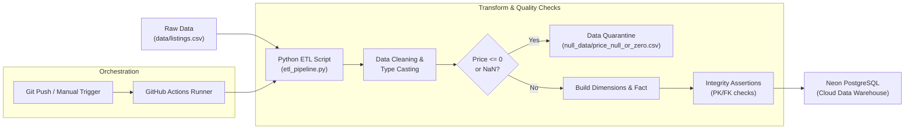
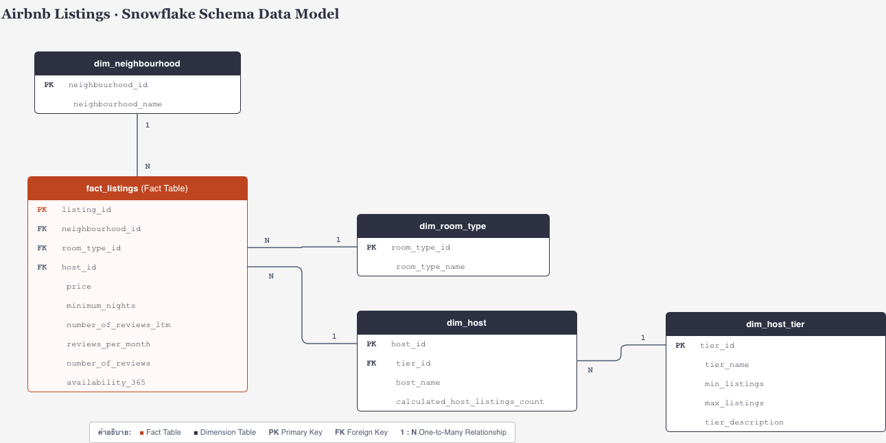

# 🏠 Airbnb Bangkok Automated ETL Pipeline & Data Warehouse

[](https://www.python.org/)
[](https://neon.tech/)
[](https://github.com/features/actions)
[](https://pandas.pydata.org/)
[](https://www.sqlalchemy.org/)

ระบบ Automated Data Pipeline แบบ End-to-End สำหรับสกัด (Extract), ทำความสะอาดและแปลงรูป (Transform), และนำเข้า (Load) ข้อมูลที่พัก Airbnb ในเขตกรุงเทพมหานคร สู่ Cloud Data Warehouse (Neon Serverless PostgreSQL) ตามหลักการ **Dimensional Modeling (Snowflake Schema ในรูปแบบ 3NF)** เพื่อรองรับการวิเคราะห์ Business Intelligence (BI) และตอบโจทย์การลงทุนปล่อยเช่าห้องพักอย่างมีประสิทธิภาพ

---

## 📌 สารบัญ (Table of Contents)
1. [โจทย์และวัตถุประสงค์ทางธุรกิจ (Business Objectives)](#-โจทย์และวัตถุประสงค์ทางธุรกิจ-business-objectives)
2. [สถาปัตยกรรมข้อมูลและไปป์ไลน์ (Architecture Overview)](#-สถาปัตยกรรมข้อมูลและไปป์ไลน์-architecture-overview)
3. [การออกแบบโมเดลข้อมูล (Data Modeling)](#-การออกแบบโมเดลข้อมูล-data-modeling)
4. [นโยบายคุณภาพข้อมูล (Data Quality & Quarantine Policy)](#-นโยบายคุณภาพข้อมูล-data-quality--quarantine-policy)
5. [โครงสร้างโปรเจกต์ (Project Structure)](#-โครงสร้างโปรเจกต์-project-structure)
6. [การติดตั้งและใช้งาน (Getting Started)](#-การติดตั้งและใช้งาน-getting-started)
7. [ระบบอัตโนมัติ (CI/CD Automation with GitHub Actions)](#-ระบบอัตโนมัติ-cicd-automation-with-github-actions)

---

## 🎯 โจทย์และวัตถุประสงค์ทางธุรกิจ (Business Objectives)

โปรเจกต์นี้ถูกออกแบบขึ้นเพื่อสนับสนุนการตัดสินใจของนักลงทุนและผู้ประกอบการปล่อยเช่าที่พัก โดยมุ่งเน้นตอบโจทย์สำคัญ 3 ด้าน:

1. **ปัจจัยด้านทำเลและเงื่อนไขระยะเวลาพักต่อราคาต่อคืน**: วิเคราะห์หาความสัมพันธ์ระหว่างย่านที่ตั้ง (Neighbourhood), ประเภทห้องพัก (Room Type) และข้อกำหนดคืนขั้นต่ำ (Minimum Nights) ที่ส่งผลต่อราคาเฉลี่ยต่อคืน
2. **จุดยอมรับราคาของผู้เช่าและจุดต้านของคืนขั้นต่ำ**: ประเมินดีมานด์ของผู้เช่าผ่านอัตราการรีวิว (`reviews_per_month` และ `number_of_reviews_ltm`) เพื่อหาจุดสมดุลของราคาและจำนวนคืนขั้นต่ำที่ไม่ทำให้เสียโอกาสทางการตลาด
3. **ย่านศักยภาพสูง กำไรคุ้มค่า คู่แข่งรายใหญ่น้อย**: ค้นหาย่านที่มีความต้องการเช่าสูงและราคาต่อคืนน่าดึงดูด โดยมีสัดส่วนของกลุ่มทุนเอเจนซี่รายใหญ่ (`dim_host_tier` ระดับ Large/Agency $\ge 20$ ห้อง) อยู่ในสัดส่วนที่ต่ำ เพื่อเปิดโอกาสให้ผู้เช่ารายย่อยแข่งขันได้ง่าย

---

## 🏗 สถาปัตยกรรมข้อมูลและไปป์ไลน์ (Architecture Overview)

กระบวนการ ETL ดำเนินการแบบอัตโนมัติและคงคุณสมบัติ **Idempotency** (สามารถรันซ้ำได้โดยผลลัพธ์คงเดิมและไม่เกิดข้อมูลซ้ำซ้อน):



### ขั้นตอนการทำงานของ Pipeline:
1. **Extract**: สกัดข้อมูลดิบจาก Landing Zone (`data/listings.csv`) ซึ่งมีข้อมูลตั้งต้นกว่า 30,000+ แถว
2. **Transform**:
   - คัดกรองเลือกเฉพาะ 14 ฟิลด์หลักที่จำเป็นต่อการวิเคราะห์
   - จัดการค่าว่างและตรวจสอบความถูกต้องตามเกณฑ์ทางธุรกิจ
   - จัดกลุ่มและ Normalization ข้อมูลให้อยู่ในรูป 3NF พร้อมสร้าง Surrogate Keys
   - ตรวจสอบความถูกต้องของข้อมูล (Assertion Checks) 100% ทั้ง Primary Key, Foreign Key และ Non-null constraints
3. **Load**:
   - เคลียร์ข้อมูลเดิมในตารางด้วยคำสั่ง `TRUNCATE TABLE ... CASCADE;`
   - โหลดตารางมิติ (Dimensions) ก่อนตามลำดับ DAG Dependencies แล้วตามด้วยตารางข้อเท็จจริง (`fact_listings`) โดยแบ่งโหลดเป็นก้อน (Chunk size: 5,000 แถว) เพื่อประสิทธิภาพสูงสุด

---

## 📊 การออกแบบโมเดลข้อมูล (Data Modeling)

ระบบออกแบบตามสถาปัตยกรรม **Snowflake Schema** (โดยเชื่อมต่อไปยัง Outrigger Dimension เพื่อคงคุณสมบัติ **Third Normal Form: 3NF**) เพื่อเพิ่มประสิทธิภาพในการคิวรีวิเคราะห์ข้อมูล (OLAP) ลดความซ้ำซ้อนของข้อมูล และขจัดปัญหา Transitive Dependency:

<p align="center">
  
</p>

### องค์ประกอบของ Data Model
- 🟧 **Fact Table (ตารางข้อเท็จจริง)**: ศูนย์กลางของโมเดล คือ `fact_listings` บันทึกตัวชี้วัดเชิงปริมาณ (Quantitative Metrics) ของประกาศที่พักแต่ละรายการ
- ⬛ **Dimension Tables (ตารางมิติ)**: ให้บริบทสำหรับการวิเคราะห์ จำแนกตามมิติทำเล (`dim_neighbourhood`), ประเภทห้องพัก (`dim_room_type`), ข้อมูลผู้ให้เช่า (`dim_host`) และการจัดระดับผู้ประกอบการ (`dim_host_tier`)
- 🔗 **ความสัมพันธ์ (Relationships & Cardinality)**:
  - `dim_neighbourhood` (1) $\rightarrow$ (N) `fact_listings` เชื่อมโยงด้วย `neighbourhood_id`
  - `dim_room_type` (1) $\rightarrow$ (N) `fact_listings` เชื่อมโยงด้วย `room_type_id`
  - `dim_host` (1) $\rightarrow$ (N) `fact_listings` เชื่อมโยงด้วย `host_id`
  - `dim_host_tier` (1) $\rightarrow$ (N) `dim_host` เชื่อมโยงด้วย `tier_id` (Outrigger Dimension ขจัดความซ้ำซ้อนของการจัดกลุ่มผู้ให้เช่า)

### รายละเอียดโครงสร้างตาราง (Data Dictionary)

| ตาราง | ชนิด | คีย์หลัก / คีย์นอก | คอลัมน์และคำอธิบาย |
| :--- | :--- | :--- | :--- |
| `fact_listings` | **Fact Table** | **PK:** `listing_id`<br>**FK:** `neighbourhood_id`, `room_type_id`, `host_id` | เก็บตัวชี้วัดผลการดำเนินงานของประกาศที่พัก:<br>• `price`: ราคาที่พักต่อคืน (THB)<br>• `minimum_nights`: จำนวนคืนขั้นต่ำที่รับจอง<br>• `number_of_reviews_ltm`: ยอดรีวิวในรอบ 12 เดือนล่าสุด<br>• `reviews_per_month`: อัตราการรีวิวเฉลี่ยต่อเดือน (ตัวแทนดีมานด์)<br>• `number_of_reviews`: ยอดรีวิวสะสมทั้งหมด<br>• `availability_365`: จำนวนวันที่ห้องว่างให้จองในรอบปี |
| `dim_neighbourhood` | **Dimension** | **PK:** `neighbourhood_id` | ข้อมูลทำเลที่ตั้ง:<br>• `neighbourhood_name`: ชื่อเขต 50 เขตในกรุงเทพมหานคร |
| `dim_room_type` | **Dimension** | **PK:** `room_type_id` | ประเภทของห้องพัก:<br>• `room_type_name`: เช่น Entire home/apt, Private room, Shared room, Hotel room |
| `dim_host` | **Dimension** | **PK:** `host_id`<br>**FK:** `tier_id` | ข้อมูลผู้ให้เช่าที่พัก:<br>• `host_name`: ชื่อของผู้ให้เช่า<br>• `calculated_host_listings_count`: จำนวนประกาศห้องพักทั้งหมดที่ผู้ให้เช่าคนนี้บริหารอยู่ |
| `dim_host_tier` | **Outrigger Dimension** | **PK:** `tier_id` | การจัดระดับขนาดผู้ประกอบการเพื่อตอบโจทย์วิเคราะห์การแข่งขัน:<br>• **Tier 1 (Single Host)**: 1 ห้องพัก (เจ้าของบ้านรายย่อย)<br>• **Tier 2 (Small Scale)**: 2–5 ห้องพัก (ผู้ประกอบการรายย่อย)<br>• **Tier 3 (Medium Scale)**: 6–19 ห้องพัก (ผู้ประกอบการระดับกลาง)<br>• **Tier 4 (Large/Agency)**: $\ge 20$ ห้องพัก (เอเจนซี่หรือกลุ่มทุนมืออาชีพ)<br>• ระบุเงื่อนไขด้วย `min_listings`, `max_listings` และคำอธิบาย `tier_description` |

---

## 🛡(Data Quality & Quarantine Policy)

เพื่อรักษาความถูกต้องตามหลักการวิเคราะห์ข้อมูลและไม่บิดเบือนสถิติ จึงมีข้อกำหนดในการคลีนข้อมูลดังนี้:

1. **ราคาที่พัก (`price`)**:
   - **นโยบาย**: ห้ามใช้ Mean/Median ในการแทนที่ค่าว่าง เนื่องจากเป็นการกุข้อมูลเทียม (Synthetic Data) ทำให้ความแปรปรวนของราคาผิดเพี้ยน และในเชิงธุรกิจ ที่พักที่ไม่ลงราคาคือที่พักที่ไม่พร้อมให้บริการ
   - **แนวทาง**: แยกแถวที่มีค่า Null หรือราคา $\le 0$ เข้าสู่ **Data Quarantine Zone** ที่ `null_data/price_null_or_zero.csv` เพื่อเก็บเป็น Audit Log
2. **จำนวนคืนขั้นต่ำ (`minimum_nights`)**:
   - กรองแถวที่เป็น Null หรือ $\le 0$ ออกเนื่องจากมีสัดส่วนน้อยมาก ($<0.01\%$) ไม่ส่งผลต่อการวิเคราะห์เชิงสถิติ
3. **อัตราการรีวิวต่อเดือน (`reviews_per_month`)**:
   - หากมีค่า Null ให้ Impute ด้วย `0.0` ภายใต้สมมติฐานทางธุรกิจว่าเป็นที่พักเปิดใหม่หรือยังไม่มีผู้เข้าพักรีวิว

---

## 📁 โครงสร้างโปรเจกต์ (Project Structure)

```text
airbnb-bangkok-pipeline/
├── .github/
│   └── workflows/
│       └── etl_pipeline.yml      # CI/CD Workflow รัน ETL อัตโนมัติบน GitHub Actions
├── assets/
│   └── data_model.png            # แผนภาพ Snowflake Schema Data Model
├── data/
│   └── listings.csv              # ไฟล์ข้อมูลดิบ (Landing Zone)
├── null_data/
│   └── price_null_or_zero.csv    # Data Quarantine สำหรับข้อมูลราคาที่ผิดปกติ
├── .env.example                  # ตัวอย่างการตั้งค่า Environment Variables
├── .gitignore                    # ระบุไฟล์และโฟลเดอร์ที่ไม่ต้องการนำขึ้น Git
├── etl_pipeline.py               # สคริปต์หลัก Automated ETL Pipeline (Python)
├── listings_etl.ipynb            # Jupyter Notebook สำหรับทดลองและวิเคราะห์ข้อมูลเบื้องต้น
├── requirements.txt              # รายการ Library dependencies
├── schema.sql                    # สคริปต์ DDL สำหรับสร้าง Table และ Foreign Key Constraints
└── README.md                     # เอกสารอธิบายรายละเอียดโปรเจกต์
```

---

## 🚀 การติดตั้งและใช้งาน (Getting Started)

### 1. ความต้องการของระบบ (Prerequisites)
- Python 3.11 หรือสูงกว่า
- บัญชีฐานข้อมูล PostgreSQL (แนะนำ [Neon.tech](https://neon.tech/) สำหรับ Serverless PostgreSQL)

### 2. โคลน Repository และสร้าง Virtual Environment
```bash
git clone https://github.com/<your-username>/airbnb-bangkok-pipeline.git
cd airbnb-bangkok-pipeline

# สร้าง virtual environment
python3 -m venv .venv
source .venv/bin/activate  # สำหรับ macOS/Linux
# .venv\Scripts\activate   # สำหรับ Windows

# ติดตั้ง Dependencies
pip install -r requirements.txt
```

### 3. กำหนดค่า Environment Variables
คัดลอกไฟล์ `.env.example` เป็น `.env` แล้วระบุ Connection String ของฐานข้อมูล:
```bash
cp .env.example .env
```
แก้ไขเนื้อหาในไฟล์ `.env`:
```ini
DATABASE_URL=postgresql://<username>:<password>@<host>/<database>?sslmode=require
```

### 4. สร้าง Schema บน Database
รันสคริปต์ DDL บนฐานข้อมูล Neon PostgreSQL:
```bash
# ตัวอย่างการรันผ่าน psql
psql "$DATABASE_URL" -f schema.sql
```

### 5. สั่งรัน ETL Pipeline
```bash
python etl_pipeline.py
```

เมื่อกระบวนการทำงานเสร็จสมบูรณ์ จะแสดงผลลัพธ์การโหลดข้อมูลและการตรวจสอบจำนวนแถวปลายทาง:
```text
==================================================================
🚀 เริ่มต้นกระบวนการ AUTOMATED ETL PIPELINE (Airbnb Bangkok)
==================================================================
📥 [Step 1/3: Extract] กำลังอ่านข้อมูลดิบจาก: data/listings.csv ...
✅ โหลดไฟล์สำเร็จ: จำนวนข้อมูลดิบทั้งหมด 30,922 แถว

🔄 [Step 2/3: Transform] กำลังทำความสะอาดข้อมูลและจัดรูป Schema...
📦 Data Quarantine: แยกข้อมูลราคาไม่สมบูรณ์ 2,259 แถว ไปที่: null_data/price_null_or_zero.csv
📊 จำนวนแถวข้อมูลสุทธิที่ผ่านเกณฑ์คุณภาพ: 28,661 แถว
✅ ผ่านการตรวจสอบ Data Integrity 100% ครบทั้ง 5 ตาราง

🚀 [Step 3/3: Load] กำลังเชื่อมต่อและโหลดข้อมูลขึ้น Neon PostgreSQL...
🧹 เคลียร์ข้อมูลเดิมในตารางเรียบร้อย
✅ โหลด dim_neighbourhood สำเร็จ (50 แถว)
✅ โหลด dim_room_type สำเร็จ (4 แถว)
✅ โหลด dim_host_tier สำเร็จ (4 แถว)
✅ โหลด dim_host สำเร็จ (11,489 แถว)
✅ โหลด fact_listings สำเร็จ (28,661 แถว)

🎯 ยืนยันยอดข้อมูลจริงบน Neon DW: 28,661 แถว (เป้าหมาย: 28,661 แถว)

🎉 จบกระบวนการ Automated ETL Pipeline สำเร็จสมบูรณ์ 100%!
```

---

## ⚙️ ระบบอัตโนมัติ (CI/CD Automation with GitHub Actions)

โปรเจกต์นี้มาพร้อม CI/CD Workflow (`.github/workflows/etl_pipeline.yml`) ซึ่งจะทำงานอัตโนมัติเมื่อ:
- มีการ **Push** หรือเปลี่ยนแปลงไฟล์ข้อมูล `data/listings.csv`
- กดเรียกใช้งานเองแบบ **Manual Trigger** (`workflow_dispatch`) ผ่านแท็บ Actions บน GitHub

### การตั้งค่า GitHub Secrets:
1. ไปที่ GitHub Repository ของคุณ $\rightarrow$ **Settings** $\rightarrow$ **Secrets and variables** $\rightarrow$ **Actions**
2. กดปุ่ม **New repository secret**
3. กำหนดชื่อ `NEON_DATABASE_URL` และใส่ Connection String ของฐานข้อมูล Neon

---


